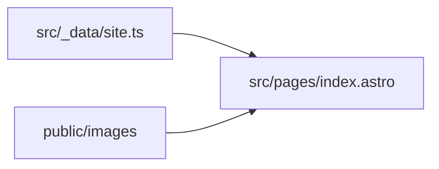

# Link bio Flaviano

Página única de atendimento, no formato de link da bio: banner, atalhos de WhatsApp e Instagram e lojas.

## Stack

- Astro 7
- HTML e CSS, sem framework de interface
- pnpm
- Conteúdo estático, sem banco e sem login

## Regras de negócio

- A página é pública.
- O WhatsApp aceita `https://w.app`, `https://wa.me` e `https://api.whatsapp.com`, ou um telefone brasileiro com DDI `55`.
- O perfil do Instagram vira link de stories em `https://www.instagram.com/stories/usuario/`.
- Cada loja abre uma busca no Google Maps em `https://www.google.com/maps/search/`, com o endereço e a cidade.
- Textos são renderizados como texto, sem HTML vindo de fora.

## Estrutura

```text
public/images/          banner
src/pages/index.astro   rota da página
src/_components/        blocos da interface
src/_data/site.ts       textos, telefones e lojas
src/_data/images.ts     localizador dos arquivos de imagem
src/_layouts/           documento HTML
src/_styles/global.css  visual
changelogs/             histórico das mudanças
```

Não há entidades persistidas.



## Como rodar

```bash
pnpm install
pnpm dev
pnpm build
```

Não há variáveis de ambiente.

## Imagens

Coloque os arquivos em `public/images/`. A página procura, nesta ordem, `.webp`, `.png`, `.jpg`, `.jpeg` e `.avif`.

- `banner` — imagem quadrada do topo

Enquanto o arquivo não existir, o espaço do banner continua reservado.

## Textos e links

Edite `src/_data/site.ts`.

- `whatsappUrl`: link do botão flutuante, de compra e da assistência
- `instagramProfileUrl`: perfil do Instagram; o clique abre os stories
- `stores`: nome, endereço, cidade (usada só na busca do mapa) e CEP de cada loja
- `legalName`, `cnpj` e `coverage`: rodapé

## Changelog

- [2026-10-29 — página de link da bio](changelogs/2026-10-29-pagina-link-bio.md)
- [2026-10-29 — remoção da imagem de promoção](changelogs/2026-10-29-remover-imagem-promocao.md)
- [2026-10-29 — links de WhatsApp e stories](changelogs/2026-10-29-links-whatsapp-stories.md)
- [2026-10-29 — CNPJ e endereços das lojas](changelogs/2026-10-29-cnpj-enderecos-lojas.md)
- [2026-10-29 — brasões das cidades](changelogs/2026-10-29-brasoes-cidades.md)
- [2026-10-29 — lojas no Google Maps](changelogs/2026-10-29-lojas-google-maps.md)
